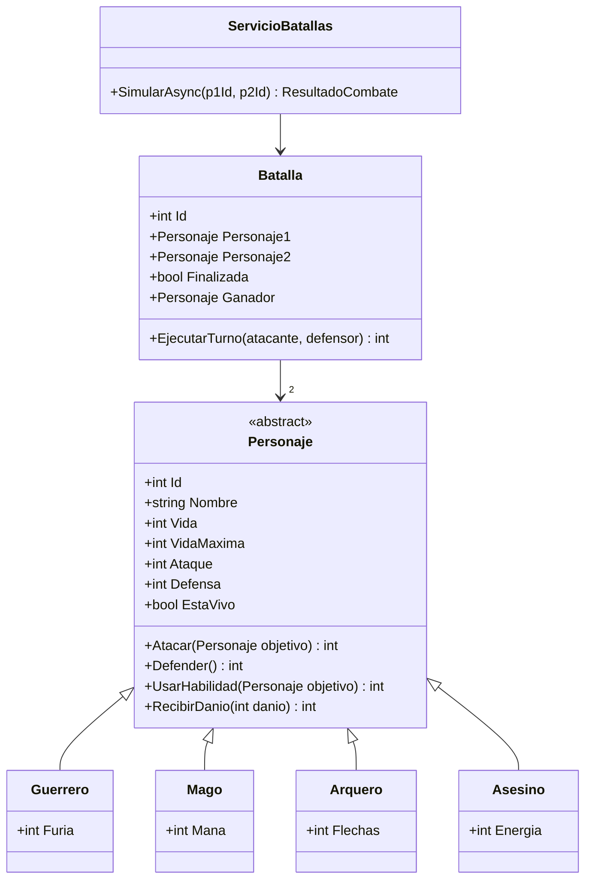
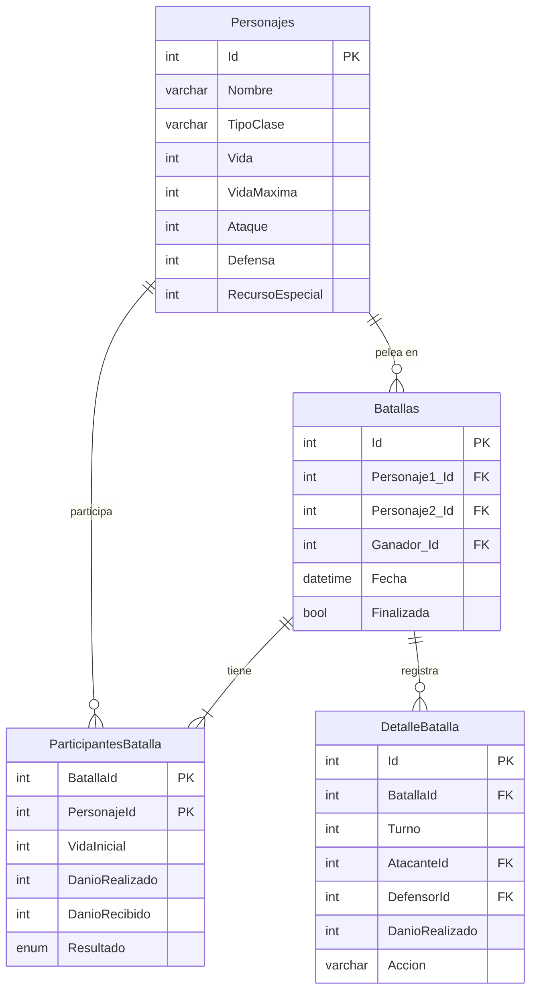

# Punto de partida: un combate visto desde afuera

Esto lo escribí antes de programar la API, usando lo que ya sabía del proyecto anterior (**Código en combate**, 3er bimestre), donde el combate era una app de consola que simulaba toda la pelea de una y la guardaba en MySQL con stored procedures. La idea es dejar registrado lo que imaginaba al principio para después compararlo con el resultado final.

---

## 1. Qué haría un cliente

Imagino una aplicación cliente (por ejemplo un juego o una página) que quiere hacer esto:

1. Crear dos personajes.
2. Iniciar un combate entre los dos.
3. Ejecutar un turno.

### Paso 1: crear dos personajes

El cliente manda los datos del personaje. Al principio pensaba que tenía que mandar todo, o sea nombre, clase, vida, ataque, defensa y el recurso, tal como lo hacía en el `Program.cs` del bimestre pasado (`new Guerrero("Thorin", 100, 25, 10, 10)`).

```http
POST /api/personajes
Content-Type: application/json

{ "nombre": "Thorin", "clase": "Guerrero", "vida": 100, "ataque": 25, "defensa": 10, "recurso": 10 }
```

Lo que esperaría recibir:

```json
{ "id": 1, "nombre": "Thorin", "clase": "Guerrero", "vida": 100, "ataque": 25, "defensa": 10, "furia": 10 }
```

Y lo mismo para el segundo personaje, por ejemplo un Mago (Gandalf).

**Qué podría salir mal:**
- Que mande una clase que no existe (por ejemplo "Paladín").
- Que el nombre venga vacío.
- Que la vida, el ataque o la defensa vengan en 0 o negativos.
- Que el JSON esté mal escrito.

### Paso 2: iniciar el combate

```http
POST /api/batallas
{ "personaje1Id": 1, "personaje2Id": 2 }
```

Mi primera idea era que este POST hiciera **todo el combate de una**, igual que `ServicioBatallas.SimularAsync` del bimestre pasado: carga los dos personajes, pelean en memoria hasta que uno muere y se guarda el resultado. La respuesta sería algo así:

```json
{
  "batallaId": 1,
  "ganador": "Thorin",
  "turnosJugados": 4,
  "turnos": [
    { "numero": 1, "actor": "Thorin", "accion": "Ataque Básico", "danio": 20, "objetivo": "Gandalf" }
  ]
}
```

**Qué podría salir mal:**
- Que los dos Id sean el mismo personaje.
- Que algún Id no exista.
- Que uno de los personajes ya esté muerto.

### Paso 3: ejecutar un turno

Acá me surgió la duda, porque si el combate se simula entero en el paso 2, ¿para qué ejecutar un turno aparte? Supongo que el cliente quiere controlar la pelea turno por turno, entonces debería ser algo así:

```http
POST /api/batallas/1/turnos
{ "atacanteId": 1, "accion": "atacar" }
```

Y la respuesta sería el daño hecho y cómo quedaron los dos.

**Qué podría salir mal:**
- Que ataque el que no le toca.
- Que el combate ya haya terminado.
- Que la acción no exista.
- Que el atacante no sea parte del combate.

---

## 2. Datos comunes y comportamientos propios

**Datos comunes (van en la clase base `Personaje`):** Id, Nombre, Vida, VidaMaxima, Ataque y Defensa, más si está vivo o no.

**Comportamientos comunes:**
- `RecibirDanio`: resta la defensa, hace como mínimo 1 de daño y la vida nunca queda negativa.
- No poder actuar si está derrotado.

**Comportamientos propios de cada clase (polimorfismo):**

| Clase | Recurso | Atacar | Habilidad | Defender |
|---|---|---|---|---|
| Guerrero | Furia | Si tiene 20 de furia pega +15, si no junta furia | Golpe Devastador (×1.5) | Junta furia |
| Mago | Maná | Proyectil normal | Bola de Fuego (×2, gasta 10 de maná) | Recupera maná |
| Arquero | Flechas | Con flechas +10, sin flechas la mitad | Lluvia de Flechas (×2, gasta 3) | Recupera una flecha |
| Asesino | Energía | Con energía golpe triple | Puñalada Letal (×3) | Esquiva el próximo golpe |

La idea es que el combate llame a `atacante.Atacar(defensor)` y que cada clase resuelva su ataque, sin preguntar con `if` de qué clase es.

---

## 3. Qué hay que conservar después de cada turno

- El número de turno.
- Quién atacó y a quién.
- Qué acción usó.
- Cuánto daño hizo.
- El daño acumulado de cada participante, como en `ParticipantesBatalla`.
- Si el combate terminó y quién ganó.

---

## 4. Modelo inicial

### Diagrama de clases (lo que imaginaba)



### DER (lo que imaginaba, basado en el bimestre anterior)



---

## 5. Hipótesis

1. El POST de combate va a simular toda la pelea de una, como `ServicioBatallas.SimularAsync`.
2. Los endpoints pueden devolver directamente las entidades (`Personaje`, `Batalla`), así es menos código.
3. Con un solo usuario de base de datos alcanza, como `5to_agbd` del bimestre pasado.
4. Las operaciones importantes (registrar turno, finalizar) se siguen haciendo con stored procedures.
5. Para deshacer un turno alcanza con borrar la fila de `DetalleBatalla`.
6. Las tablas y estadísticas del bimestre pasado (`ParticipantesBatalla` y los SP de estadísticas) se pueden reutilizar tal cual.
7. El cliente manda todas las estadísticas del personaje al crearlo.

## 6. Dudas

**Sobre rutas:**
- ¿El Id va en la ruta (`/api/personajes/1`) o en el cuerpo del JSON?
- ¿Los turnos van "adentro" del combate (`/api/combates/1/turnos`) o en una ruta aparte?
- ¿Qué diferencia hay entre usar PUT y POST?

**Sobre respuestas:**
- ¿Qué código devuelvo cuando algo no existe y cuál cuando los datos están mal?
- ¿Al crear algo se devuelve 200 o 201?
- ¿Un DELETE devuelve el objeto borrado o nada?
- ¿Qué devuelvo si quiero borrar algo que no se puede borrar porque tiene historial?

**Sobre permisos de la base de datos:**
- ¿Qué permisos necesita un usuario que solo consulta?
- ¿Cómo hago para que la API use un usuario para leer y otro para escribir?
- ¿Dónde pongo las contraseñas para que no queden subidas a GitHub?
- ¿Qué tiene que tener un backup para poder reconstruir todo?
